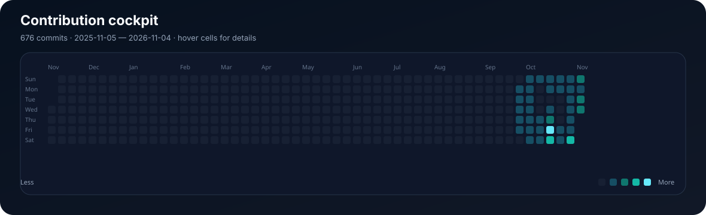

# Hi, I'm Snowstorm 👋

  <strong>Computer Engineering student · Product builder · Data-minded developer</strong> 
  I turn messy data and ambitious ideas into useful, reliable software.

  
  

## 🎾 Featured project

### Tennisd — a tennis match diary

Discover ATP/WTA matches, record what you watched, rate matches, write reviews,
follow players and build a personal tennis history.

<table>
  <tr>
    <td><strong>Product</strong> Public match discovery, diary, reviews, watchlists and profiles</td>
    <td><strong>Engineering</strong> Flask · PostgreSQL · SQLAlchemy · GitHub Actions</td>
  </tr>
  <tr>
    <td><strong>Reliability</strong> 177 automated tests and PostgreSQL smoke checks</td>
    <td><strong>Operations</strong> Render deployment, encrypted backups and restore verification</td>
  </tr>
</table>

## 🍿 Movie Fountain — Movie Finder

An expressive movie-discovery interface that helps people find something to
watch without endless scrolling.

  
  

<table>
  <tr>
    <td><strong>Product</strong> Animated movie discovery, genres, moods, search, cast and recommendations</td>
    <td><strong>Engineering</strong> Cloudflare Pages · Pages Functions · TMDB API · JavaScript</td>
  </tr>
  <tr>
    <td><strong>Personalisation</strong> Local watchlist, watched marks and JSON import/export</td>
    <td><strong>Safety</strong> API credentials stay server-side and reduced-motion support is built in</td>
  </tr>
</table>

## 🎓 Lotus Campus

A calm campus platform for university students in Azerbaijan, bringing groups,
courses, schedules, events, messaging and an AI study assistant into one place.

  

<table>
  <tr>
    <td><strong>Product</strong> University feed, groups, courses, schedules, events, deadlines and messaging</td>
    <td><strong>Engineering</strong> HTML · CSS · JavaScript · Cloudflare Pages Functions</td>
  </tr>
  <tr>
    <td><strong>Platform</strong> Supabase Auth, Postgres, Row Level Security and Storage</td>
    <td><strong>Experience</strong> Onboarding, profiles, privacy settings and AI study assistance</td>
  </tr>
</table>

## 📊 Contribution cockpit

  Real daily commit activity from <strong>Tennisd</strong>, <strong>Movie Finder</strong>
  and <strong>Lotus</strong>. Hover cells in the SVG for the date and project split,
  or open the <a href="https://snowstormme.github.io/Snowstormme/activity.html">interactive dashboard</a> for a full tooltip view.

<table>
  <tr>
    <td><strong>Build</strong> Daily commits across three projects</td>
    <td><strong>Versions</strong> Current versions read from each repository</td>
    <td><strong>Explore</strong> Open the interactive dashboard for tooltips</td>
  </tr>
</table>

## 🧭 What I care about

- Making data-heavy products understandable
- Secure defaults and privacy-aware user flows
- Tests that protect real behaviour, not just line coverage
- Small releases that can be verified and rolled back
- Honest product documentation and transparent limitations

## 🛠️ Tools I use

`Python` `Flask` `PostgreSQL` `SQLAlchemy` `JavaScript` `HTML/CSS`
`GitHub Actions` `Render` `Neon`

## 🚧 Current focus

- Improving Tennisd's search and tournament discovery
- Making imported tennis data more reliable and explainable
- Building safer account, notification and recovery flows

## 📬 Find me

<a href="https://github.com/Snowstormme">GitHub</a> ·
<a href="https://tennisd.onrender.com/">Tennisd</a> ·
<a href="https://movie-fountain.pages.dev/">Movie Fountain</a> ·
<a href="https://github.com/Snowstormme/lotus">Lotus</a>

Built carefully, shipped incrementally.
