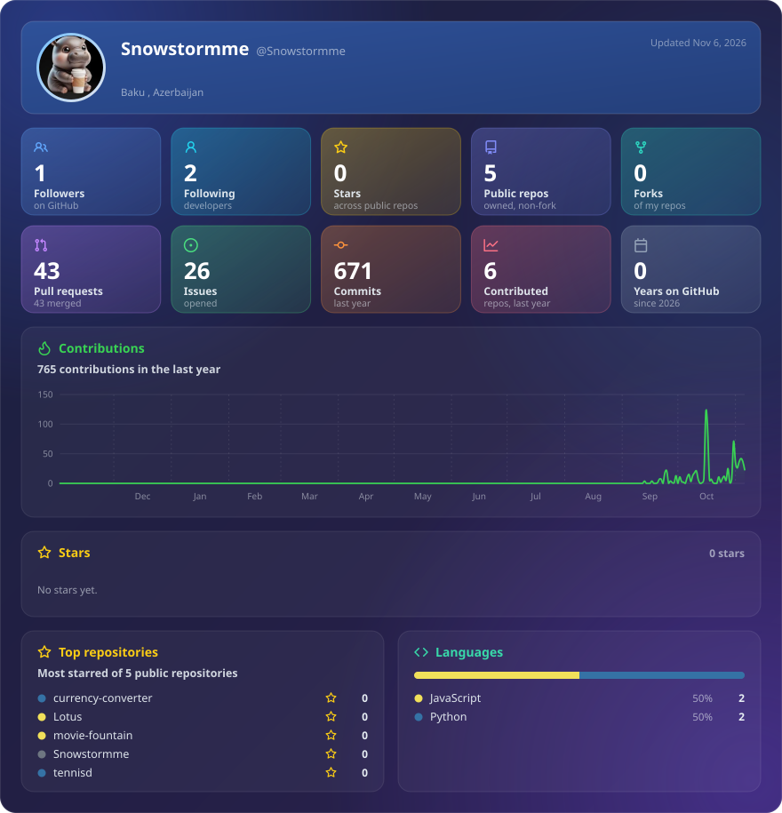
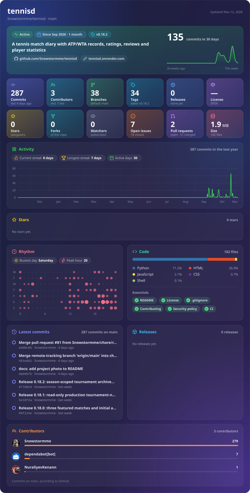
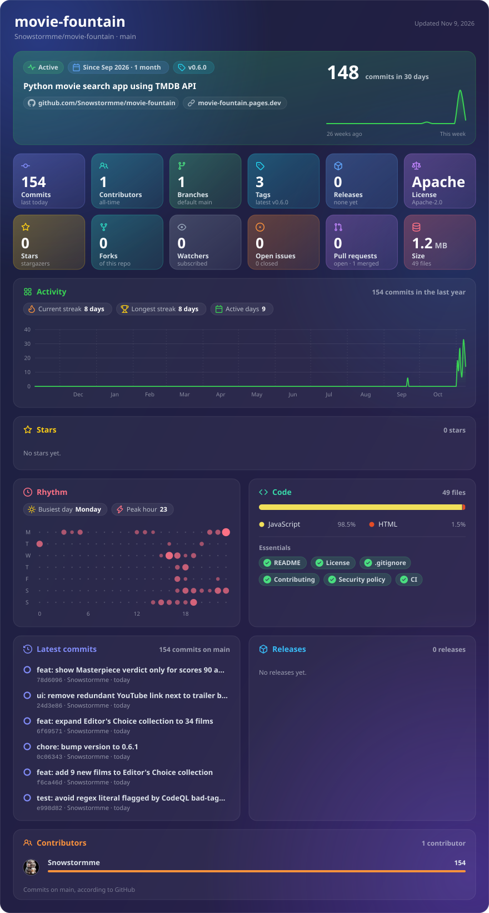
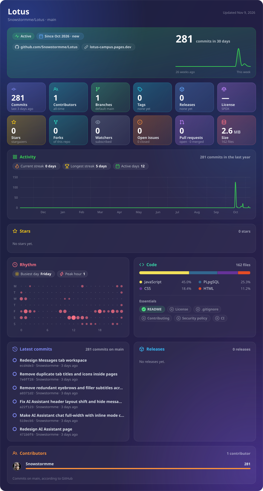

<table>
  <tr>
    <td valign="top" width="40%">
      
       
       
       
       
       
      
    </td>
    <td align="right" valign="middle" width="60%">
      
    </td>
  </tr>
</table>

## ✨ GitHub at a glance

## 🧩 Project studio

### 🎾 Tennisd

Discover ATP/WTA matches, record what you watched, rate matches, write reviews,
follow players and build a personal tennis history.

<table>
  <tr><td><strong>Product</strong> Match discovery, diary, reviews, watchlists and profiles</td><td><strong>Engineering</strong> Flask · PostgreSQL · SQLAlchemy · GitHub Actions</td></tr>
  <tr><td><strong>Reliability</strong> 177 automated tests and PostgreSQL smoke checks</td><td><strong>Operations</strong> Render deployment, encrypted backups and restore verification</td></tr>
</table>

<a href="https://tennisd.onrender.com/">Open Tennisd</a> · <a href="https://github.com/Snowstormme/tennisd">Read the source</a>

  
  

  
Open the live Tennisd Glancecard

  

### 🍿 Movie Fountain

An expressive movie-discovery interface that helps people find something to
watch without endless scrolling. The moving Fountain combines TMDB discovery,
Streaming Services Hub (dedicated Netflix & Apple TV+ catalogs with 14-region flag selection),
Where to Watch streaming availability (JustWatch), curated Editor's Choice (34 masterpieces),
IMDb Top 250 & Letterboxd Top 500 collections with real-time in-list
sorting, multi-source ratings, official vector platform logos, director & actor
filmographies, custom profile avatars, and dual themes (Flame Orange & Midnight Sapphire).

<table>
  <tr><td><strong>Product</strong> Streaming Services Hub (Netflix &amp; Apple TV+ catalogs with 14-region country filter &amp; pagination), Animated Fountain discovery, Where to Watch streaming providers (JustWatch), curated Editor's Choice (34 films), dedicated Trending, Upcoming, IMDb Top 250 &amp; Letterboxd Top 500 charts with real-time sorting, YouTube trailers, and full filmographies</td><td><strong>Engineering</strong> Cloudflare Pages · Pages Functions · Multi-provider TMDB &amp; JustWatch streaming data · External rating APIs · Vanilla JavaScript · GitHub Actions CI</td></tr>
  <tr><td><strong>Personalisation &amp; Ratings</strong> Composite Fountain Score with golden Masterpiece consensus verdict (90+), multi-source ratings with official IMDb &amp; Letterboxd vector logos, Cinephile Passport with ranks &amp; stats, local profile avatars with Canvas compression, JSON import/export, and Classic / Midnight Sapphire Liquid Glass themes</td><td><strong>Safety</strong> API credentials stay server-side with strict CSP headers; pause controls, reduced-motion support, and private local-only storage</td></tr>
</table>

<a href="https://movie-fountain.pages.dev/">Open Movie Fountain</a> · <a href="https://github.com/Snowstormme/movie-fountain">Read the source</a>

  
  

  
Open the live Movie Fountain Glancecard

  

### 🎓 Lotus Campus

A calm campus platform for university students in Azerbaijan, bringing groups,
courses, schedules, events, messaging and an AI study assistant into one place.
It is designed as one workspace for the everyday student journey, not a pile of
separate utilities.

<table>
  <tr><td><strong>Product</strong> Home dashboard, university feed, groups, courses, materials, schedules, events, deadlines and messaging</td><td><strong>Engineering</strong> HTML · CSS · JavaScript · Cloudflare Pages Functions</td></tr>
  <tr><td><strong>Platform</strong> Supabase Auth, Postgres, Row Level Security and Storage</td><td><strong>Experience</strong> Daily/weekly/monthly schedule views, RSVP flows, onboarding, privacy settings and AI study assistance</td></tr>
</table>

<a href="https://github.com/Snowstormme/lotus">Read the Lotus source</a>

  

  
Open the live Lotus Glancecard

  

## 🧭 Working principles

| Signal | How it shows up in the work |
| --- | --- |
| 🧱 Product thinking | Features are shaped around a clear user job |
| 🔐 Secure defaults | Secrets stay server-side; private data stays scoped |
| 🧪 Real tests | Critical user flows and database behaviour are exercised |
| 🚀 Small releases | Changes are easy to verify, deploy and roll back |
| 📝 Honest docs | Limitations and data freshness are documented clearly |

## 🛠️ Tools I use

`Python` `Flask` `PostgreSQL` `SQLAlchemy` `JavaScript` `HTML/CSS`
`GitHub Actions` `Render` `Cloudflare Pages` `Supabase` `Neon`

