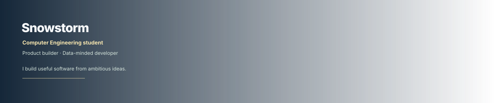
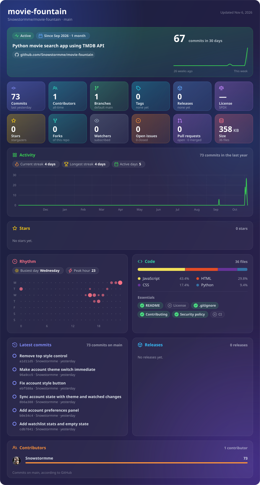

  

  

  
  
  

## ✨ GitHub at a glance

## 🧩 Project studio

### 🎾 Tennisd

Discover ATP/WTA matches, record what you watched, rate matches, write reviews,
follow players and build a personal tennis history.

<table>
  <tr><td><strong>Product</strong> Match discovery, diary, reviews, watchlists and profiles</td><td><strong>Engineering</strong> Flask · PostgreSQL · SQLAlchemy · GitHub Actions</td></tr>
  <tr><td><strong>Reliability</strong> 177 automated tests and PostgreSQL smoke checks</td><td><strong>Operations</strong> Render deployment, encrypted backups and restore verification</td></tr>
</table>

<a href="https://tennisd.onrender.com/">Open Tennisd</a> · <a href="https://github.com/Snowstormme/tennisd">Read the source</a>

  
  

  
Open the live Tennisd Glancecard

  

### 🍿 Movie Fountain — Movie Finder

An expressive movie-discovery interface that helps people find something to
watch without endless scrolling. The moving Fountain combines TMDB discovery
with practical filters and a local watchlist.

<table>
  <tr><td><strong>Product</strong> Animated discovery, genre/mood filters, year and length controls, search, cast and recommendations</td><td><strong>Engineering</strong> Cloudflare Pages · Pages Functions · TMDB API · JavaScript</td></tr>
  <tr><td><strong>Personalisation</strong> Local watchlist, watched marks, JSON import/export and shareable movie links</td><td><strong>Safety</strong> API credentials stay server-side; pause controls and reduced-motion support are built in</td></tr>
</table>

<a href="https://movie-fountain.pages.dev/">Open Movie Fountain</a> · <a href="https://github.com/Snowstormme/movie-finder">Read the source</a>

  
  

  
Open the live Movie Finder Glancecard

  

### 🎓 Lotus Campus

A calm campus platform for university students in Azerbaijan, bringing groups,
courses, schedules, events, messaging and an AI study assistant into one place.
It is designed as one workspace for the everyday student journey, not a pile of
separate utilities.

<table>
  <tr><td><strong>Product</strong> Home dashboard, university feed, groups, courses, materials, schedules, events, deadlines and messaging</td><td><strong>Engineering</strong> HTML · CSS · JavaScript · Cloudflare Pages Functions</td></tr>
  <tr><td><strong>Platform</strong> Supabase Auth, Postgres, Row Level Security and Storage</td><td><strong>Experience</strong> Daily/weekly/monthly schedule views, RSVP flows, onboarding, privacy settings and AI study assistance</td></tr>
</table>

<a href="https://github.com/Snowstormme/lotus">Read the Lotus source</a>

  

  
Open the live Lotus Glancecard

  

## 🧭 Working principles

| Signal | How it shows up in the work |
| --- | --- |
| 🧱 Product thinking | Features are shaped around a clear user job |
| 🔐 Secure defaults | Secrets stay server-side; private data stays scoped |
| 🧪 Real tests | Critical user flows and database behaviour are exercised |
| 🚀 Small releases | Changes are easy to verify, deploy and roll back |
| 📝 Honest docs | Limitations and data freshness are documented clearly |

## 🛠️ Tools I use

`Python` `Flask` `PostgreSQL` `SQLAlchemy` `JavaScript` `HTML/CSS`
`GitHub Actions` `Render` `Cloudflare Pages` `Supabase` `Neon`

## 🚧 Current focus

- Improving Tennisd's search and tournament discovery
- Making imported data more reliable and explainable
- Keeping Movie Fountain playful without sacrificing accessibility
- Turning Lotus into a calmer, safer student workspace

## 📬 Find me

<a href="https://github.com/Snowstormme">GitHub</a> ·
<a href="https://tennisd.onrender.com/">Tennisd</a> ·
<a href="https://movie-fountain.pages.dev/">Movie Fountain</a> ·
<a href="https://github.com/Snowstormme/lotus">Lotus</a>

Built carefully, shipped incrementally, warmed by a little winter light.

